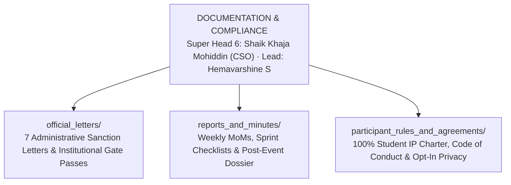

# KAIROS 2027 (Grand Edition) — Documentation & Institutional Compliance Workspace

**Document Reference:** `teams/03_documentation_and_compliance/README.md`  
**Host Entity:** AWS Student Builder Group (AWS SBG) — SIST Chapter  
**Sponsoring Department:** School of Computing, Sathyabama Institute of Science and Technology, Chennai – 600119  
**Super Head Mandate:** Super Head 6 (Chief Safety, Governance & Jury Officer — CSO Shaik Khaja Mohiddin, Reg: `44110756`)  
**Direct Leads:** **Hemavarshine S** (Documentation Lead, Reg: `44110263`, Phone: `+91 9345691593`) & **Nangaiyar M** (Operations Liaison, Reg: `44612059`)  
**Apex Executive Authority:** **Thenappan T** (President & SBGL, Reg: `44110855`, Phone: `+91 6381801640`)  
**Faculty Signatories:** **Dr. K. Ashok Kumar** & **Dr. Balapriya .S** (Dept. of CSE, SIST)  
**Institutional Authority:** **Dr. L. Lakshmanan** (Dean, School of Computing) & **Dr. T. Sasipraba** (Vice Chancellor)  
**Governing Standards:** [00_hackathon_master_brief.md](../../docs/00_hackathon_master_brief.md) · [09_participant_handbook_and_rules.md](../../docs/09_participant_handbook_and_rules.md) · [14_official_letters_and_administrative_approvals.md](../../docs/14_official_letters_and_administrative_approvals.md) · [20_indoor_auditorium_venue_transition_and_budget_plan.md](../../docs/20_indoor_auditorium_venue_transition_and_budget_plan.md)  
**Status:** `CONFIRMED MASTER OPERATING STANDARD`  

---

## 1. Domain Scope & Mandate

The Documentation & Compliance vertical is responsible for the absolute legal, administrative, and institutional integrity of KAIROS 2027. Every external and internal movement—from securing formal sanction for the **Sathyabama Indoor Stadium**, 65 kVA electrical power drops, 10 college buses, and 3 campus EV buggies, to drafting police intimation letters, capturing weekly sprint minutes, and protecting student participant IP—flows through this vertical.

---

## 2. Institutional Reference Numbering System

All formal letters drafted and dispatched by the AWS Student Builder Group — SIST Chapter must bear an official institutional tracking serial number formatted as:

$$\text{SIST/CSE/AWS-SBG/2026-27/EXT/[SERIAL\_NO]}$$

Example: `SIST/CSE/AWS-SBG/2026-27/EXT/001-REV` (Venue Requisition for Sathyabama Indoor Stadium).

---

## 3. Subfolder Directory Map & Deliverables

1. [**`official_letters/`**](./official_letters/README.md): Houses the complete compendium of university administrative sanction letters:
   - Letter 01: Sathyabama Indoor Stadium Venue & 65 kVA Power Requisition
   - Letter 02: 48-Hour Continuous Master Workflow, Night-Stay & Safety Assurance Plan
   - Letter 03: Audio-Visual, High-Density Wi-Fi 6 & Electrical Resource Requisition
   - Letter 04: Fleet Transportation Permission (10 Sathyabama College Bus Routes)
   - Letter 05: VIP Guest, Evaluator & Judge Hospitality Requisition (Green Room 2 / Mezzanine)
   - Letter 06: Green Campus EV Transit Buggies Allocation (3 Electric Vehicles)
   - Letter 07: Academic On-Duty (OD) Attendance Sanction Order for Organizers & Finalists
2. [**`reports_and_minutes/`**](./reports_and_minutes/README.md): Master repository for weekly Executive Council Minutes of Meeting (MoM), sprint task completions, crisis incident logs, and the 7-day post-event institutional dossier.
3. [**`participant_rules_and_agreements/`**](./participant_rules_and_agreements/README.md): Legal charters guaranteeing 100% student IP ownership, non-disclosure waivers, anti-plagiarism agreements, opt-in talent recruitment consent, and night-stay undertakings.

---

## 4. Archival Protocols & Physical Filing
- Every signed letter must be scanned at **300 DPI PDF**, named systematically, and filed in both the local workspace and the chapter's secured cloud repository.
- Hard copies with original institutional rubber stamps and signatures are maintained in the **AWS SBGL Physical Documentation Portfolio** in the CSE Department Office.
