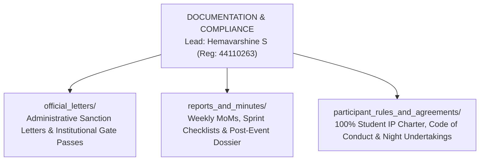

# KAIROS 2027 (Grand Edition) — Documentation & Institutional Compliance Workspace

> **Domain:** University Administrative Letters, Executive Minutes (MoM), Legal Compliance, IP Charters & Archival  
> **Direct Lead:** **Hemavarshine S** (Documentation Lead, Reg: `44110263`, Phone: `+91 9345691593`, Email: `hemavarshine07@gmail.com`)  
> **Operations Liaison:** **Nangaiyar M** (Community & Events Lead, Reg: `44612059`, Phone: `+91 8754976892`)  
> **Apex Executive Authority:** **Thenappan T** (President & SBGL, Reg: `44110855`, Phone: `+91 6381801640`)  
> **Faculty Signatories:** **Dr. K. Ashok Kumar** & **Dr. Balapriya .S** (Dept. of CSE)  
> **Institutional Authority:** **Dr. L. Lakshmanan** (Dean, School of Computing) & **Dr. T. Sasipraba** (Vice Chancellor)  

---

## 1. Domain Scope & Mandate

The Documentation & Compliance vertical is responsible for the absolute legal, administrative, and institutional integrity of KAIROS 2027. Every external and internal movement—from securing permission for 10 college buses and 2 campus EV buggies, to drafting police intimation letters, capturing weekly sprint minutes, and protecting student participant IP—flows through this vertical.

---

## 2. Institutional Reference Numbering System

All formal letters drafted and dispatched by the AWS Student Builder Group — SIST Chapter must bear an official institutional tracking serial number formatted as:

$$\text{SIST/CSE/AWS-SBG/2026-27/EXT/[SERIAL\_NO]}$$

Example: `SIST/CSE/AWS-SBG/2026-27/EXT/001` (Venue Requisition for Central Library).

---

## 3. Subfolder Directory Map & Deliverables

1. **[`official_letters/`](./official_letters/)**: Houses the complete compendium of university administrative sanction letters:
   - Letter 01: Central Library Complex Venue & Power Requisition
   - Letter 02: Fleet Transportation Permission (10 Sathyabama College Bus Routes)
   - Letter 03: Green Campus EV Transit Buggies Allocation (2 Electric Vehicles)
   - Letter 04: Semmancheri Police Station Security Intimation & Night Clearance
   - Letter 05: VIP Guest, Evaluator & Judge Honorarium / Dining Approval Memo
   - Letter 06: Student Participant Academic On-Duty (OD) Sanction Order
2. **[`reports_and_minutes/`](./reports_and_minutes/)**: Master repository for weekly Executive Council Minutes of Meeting (MoM), sprint task completions, crisis incident logs, and the 7-day post-event institutional dossier.
3. **[`participant_rules_and_agreements/`](./participant_rules_and_agreements/)**: Legal charters guaranteeing 100% student IP ownership, non-disclosure waivers, anti-plagiarism agreements, and mandatory parental consent forms for the 10 PM – 6 AM night hackathon.

---

## 4. Archival Protocols & Physical Filing
- Every signed letter must be scanned at **300 DPI PDF**, named systematically, and filed in both the local workspace and the chapter's secured cloud repository.
- Hard copies with original institutional rubber stamps and signatures are maintained in the **AWS SBGL Physical Documentation Portfolio** in the CSE Department Office.
