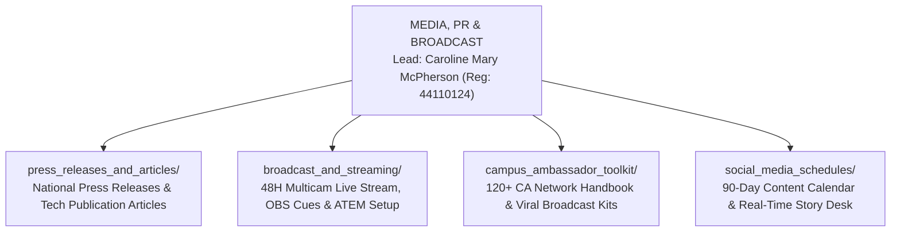

# KAIROS 2027 (Grand Edition) — Media, PR & Broadcast Workspace

> **Domain:** National Media Distribution, 48-Hour Live Broadcast, Campus Ambassador Army, Social Storytelling  
> **Direct Lead:** **Caroline Mary McPherson** (Media Head 1, Reg: `44110124`, Phone: `+91 8838990182`, Email: `mcphersoncaroline5@gmail.com`)  
> **Co-Lead (PR & Ambassador Network):** **Harshith Raj S** (Socials & PR Lead)  
> **Creative Collaborator:** **Rikish B** (Design Lead, Reg: `44110664`, Phone: `+91 9597430250`)  
> **Executive Oversight:** **Thenappan T** (President & SBGL, Reg: `44110855`, Phone: `+91 6381801640`)  

---

## 1. Domain Scope & Mandate

The Media, PR & Broadcast vertical drives the national reach, developer hype, and multi-channel storytelling of KAIROS 2027. It mobilizes over 120 Campus Ambassadors nationwide, commands the 48-hour continuous multicam livestream, distributes press releases to top national publications, and curates our flagship Instagram grid ([`@awssbg_sist`](https://instagram.com/awssbg_sist)).

---

## 2. Key Performance Indicators (KPIs)

- **National Applications:** Drive **2,000+ student applications** across 20+ Indian states.
- **Campus Ambassadors:** Deploy and manage **120+ active Campus Ambassadors**.
- **Digital Impressions:** Achieve **500,000+ cross-platform impressions** across Instagram, LinkedIn, and YouTube.
- **Continuous Live Stream:** Broadcast **48 uninterrupted hours** with 0 dropped frames and 10,000+ cumulative live views.
- **Cinematic Aftermovie:** Deliver the 4K official aftermovie within **7 business days** of event close.

---

## 3. Subfolder Directory Map & Deliverables

1. **[`press_releases_and_articles/`](./press_releases_and_articles/)**: Houses pre-written press releases ready for circulation to national dailies (The Hindu, Times of India, Indian Express, Daily Thanthi) and tech publications (TechCrunch India, YourStory, INC42, Medium, DEV.to).
2. **[`broadcast_and_streaming/`](./broadcast_and_streaming/)**: Houses the technical broadcast setup: OBS Studio scenes, ATEM Mini Pro routing profiles, audio mixer settings (-14 LUFS), 3-camera 4K setup, and hour-by-hour stream rundown cues.
3. **[`campus_ambassador_toolkit/`](./campus_ambassador_toolkit/)**: Comprehensive operations guide, referral tracking system, promo poster packs, and pre-formatted WhatsApp broadcast scripts for our 120+ national ambassadors.
4. **[`social_media_schedules/`](./social_media_schedules/)**: Master 90-day content calendar, reel storyboards, caption bank with approved hashtags (`#Kairos2027 #AWSSBGL #BuildOnAWS #SathyabamaTech`), and real-time live story desk roster.

---

## 4. Response Time & Moderation SLA
- **Instagram / LinkedIn Direct Messages:** Must be resolved within **3 hours** during active campaigns.
- **YouTube Live Chat Moderation:** 2 dedicated student moderators active on 4-hour shifts with auto-moderation bot rules enabled (blocking spam, links, profanity).
