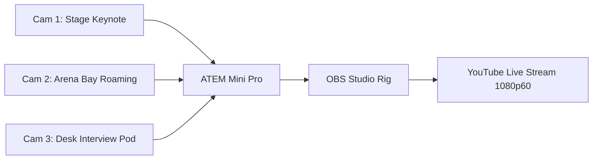

# KAIROS 2027 (Grand Edition) — Media, PR & Broadcast Workspace

> **Domain:** National Media Distribution, 48-Hour Live Broadcast, Campus Ambassador Army, Social Storytelling  
> **Direct Lead:** **Caroline Mary McPherson** (Media & PR Team Lead, Reg: `44110124`, Phone: `+91 8838990182`, Email: `mcphersoncaroline5@gmail.com`)  
> **Co-Lead (PR & Ambassador Network):** **Harshith Raj S** (Socials & PR Lead)  
> **Creative Collaborator:** **Rikish B** (Design Lead, Reg: `44110664`, Phone: `+91 9597430250`)  
> **Executive Oversight:** **Thenappan T** (President & SBGL, Reg: `44110855`, Phone: `+91 6381801640`)  

---

## 1. Team Charter & Governance

### 1.1 Mission & Vision
Division 4 acts as the megaphone and cultural narrator of KAIROS 2027. The team commands national developer attention, mobilizes a 120+ university Campus Ambassador network, broadcasts a seamless 48-hour continuous multicam livestream, and documents every breakthrough moment from opening ceremony to final trophy lift.

### 1.2 Core Mandates & Success Metrics
- **National Reach:** Generate **2,000+ national team applications** spanning 20+ Indian states (`[TARGET RUNWAY]`).
- **Campus Ambassador Force:** Recruit, onboard, and mobilize **120+ active Campus Ambassadors** across engineering institutions nationwide.
- **Multicam Live Stream:** Broadcast **48 uninterrupted hours** on YouTube Live with 0 dropped audio frames, -14 LUFS loudness compliance, and 10,000+ cumulative views.
- **Digital Footprint:** Generate **500,000+ impressions** across Instagram, LinkedIn, X, and YouTube.
- **Cinematic Aftermovie:** Deliver the 4K official cinematic aftermovie within **7 business days** of closing ceremony (`[DEADLINE: 31 JAN 2027]`).

### 1.3 Operational Boundaries (Scope of Control)
- **What This Team Controls:** Press releases, tech media pitches, YouTube stream production, OBS scene switching, camera operators, roving interviewers, Campus Ambassador incentives, Instagram grid/stories, aftermovie direction.
- **What This Team Does NOT Control:**
  - *No Graphic Asset Creation:* Master logos, vector artwork, badge layouts, and banners are authored by Division 2 (Design). Media squad formats content using approved Figma templates.
  - *No Web Hosting / Leaderboard Code:* Website development and registration webhooks are coded by Division 5 (Builder Squad).
  - *No Venue Stage Rigging:* Physical lighting, line array PA acoustic hardware, and heavy power drops are maintained by Division 6 (Operations).

---

## 2. Internal RACI Responsibility Map

```
+------------------------------------------+-------+-------+-------+-------+-------+-------+
| Media & PR Deliverable / Workstream      | Carol.| Harsh.| Stream| Roving| CA    | Pres. |
|                                          | (Media)| (PR)  | Lead  | Host  | Lead  | Then. |
+------------------------------------------+-------+-------+-------+-------+-------+-------+
| National Press Release Draft & Wire Dist.|   A   |   R   |   I   |   I   |   I   |   C   |
| 120+ Campus Ambassador Toolkit & Tasks   |   C   |   A   |   I   |   I   |   R   |   I   |
| 48-Hour Live Broadcast & Multicam Rig    |   A   |   I   |   R   |   R   |   I   |   C   |
| Roving Table Interviews & Mentor Pods    |   C   |   I   |   C   |   A   |   I   |   I   |
| Social Media Content Calendar & Stories  |   A   |   R   |   I   |   R   |   R   |   I   |
| YouTube Chat Moderation & Community SLA  |   C   |   A   |   I   |   I   |   R   |   I   |
| 4K Cinematic Aftermovie Post-Production  |   A   |   C   |   R   |   I   |   I   |   C   |
+------------------------------------------+-------+-------+-------+-------+-------+-------+
```

---

## 3. Broadcast Engineering & Multicam Livestream Workflow

The 48-hour live broadcast operates from the **Arena Stream Bay (Mezzanine / Stage Flank)**:



- **Audio Rig:** Dedicated balanced XLR output from Stadium PA line array into audio interface; loudness maintained strictly at **-14 LUFS (True Peak -1.0 dBFS)** to eliminate distortion.
- **Stream Shifts:** 3 rotating 8-hour broadcast crews (1 Director/Switcher, 1 Sound Engineer, 2 Camera Operators, 1 Live Chat Moderator).
- **Fallback Protocol:** Redundant OBS streaming profile pre-configured on a secondary laptop; 5G bonded cellular router standing by if campus fiber drops.

---

## 4. 120+ Campus Ambassador Operations & Viral Growth Engine

- **Recruitment Window:** Launched 60 days before event (`[OCTOBER – DECEMBER 2026]`).
- **Weekly Mission Drops:** CAs receive weekly promotional kits via WhatsApp community broadcast (registration milestones, track reveals, speaker drops).
- **Referral Tracking:** Unique ambassador codes track applicant conversions in Devfolio; top 10 ambassadors earn VIP Stage Passes and Official Letters of Commendation from President Thenappan T.
- **Strict Compliance Notice:** In alignment with institutional policy, CA rewards are non-monetary academic and networking honors.

---

## 5. Media Lifecycle & Operating Cadence

### 5.1 5-Phase Media Roadmap
1. **Phase 1: Brand Hype & Teaser Launch (T-90 to T-45 Days):** First press release dropped; Instagram grid rollout; CA recruitment drive.
2. **Phase 2: National Registration Surge (T-45 to T-14 Days):** Track problem statement spotlights; sponsor co-marketing posts; CA weekly sprints.
3. **Phase 3: Technical Qualifier Coverage (Round 1: Jan 02–04):** Live results broadcast; Top 100 Finalist reveal announcements.
4. **Phase 4: 48-Hour Live Event Broadcast (Jan 22–24):** Multicam livestream; hourly Instagram reels; roving midnight hacker interviews.
5. **Phase 5: Post-Event Wrap & Aftermovie (T+1 to T+14 Days):** Press release of winners; sponsor tag wraps; 4K cinematic aftermovie premiere.

### 5.2 Community Response & Moderation SLA
- **Instagram / LinkedIn Direct Messages:** Resolved within **3 hours** during active campaigns.
- **YouTube Live Chat Moderation:** Continuous moderation with auto-bot filters suppressing spam, profanity, and unverified links.
- **Crisis PR Escalation:** Any public-facing discrepancy, negative press mention, or attendee complaint must be escalated to President Thenappan T within 15 minutes before issuing any response.

---

## 6. Subfolder Directory Map & Deliverables

1. [**`press_releases_and_articles/`**](./press_releases_and_articles/README.md): Pre-written press releases ready for circulation to national dailies and tech blogs.
2. [**`broadcast_and_streaming/`**](./broadcast_and_streaming/README.md): OBS Studio profiles, ATEM Mini Pro routing profiles, audio cue sheets, and hour-by-hour stream schedules.
3. [**`campus_ambassador_toolkit/`**](./campus_ambassador_toolkit/README.md): Ambassador handbook, referral tracking guidelines, promo poster packs, and WhatsApp scripts.
4. [**`social_media_schedules/`**](./social_media_schedules/README.md): Master 90-day content calendar, reel storyboards, caption banks, and hashtag guidelines.
