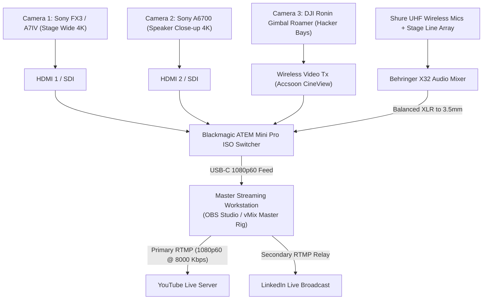

# Broadcast & 48-Hour Live Streaming Engineering Specification

> **Subfolder:** `teams/04_media_pr_and_broadcast/broadcast_and_streaming/`  
> **Direct Lead:** **Caroline Mary McPherson** (Media Head 1, Reg: `44110124`, Phone: `+91 8838990182`)  
> **Broadcast Engineer:** **Technical Media Specialist** (Assigned Lead)  
> **Network Engineer:** **Viswanathan Ashok** (Hands-On Builder Lead, Reg: `44110907`)  
> **Executive Producer:** **Thenappan T** (President & SBGL, Reg: `44110855`)  

---

## 1. Scope & Mandate

This folder manages the technical configuration, hardware routing, scene profiles, audio mixing, and minute-by-minute broadcast rundowns for the **48-Hour Continuous Multicam Live Stream** of KAIROS 2027 broadcasted to YouTube Live and LinkedIn.

---

## 2. Technical Broadcast Architecture

---

## 3. Streaming Configuration Standards

- **Video Resolution:** `1920 × 1080 px` (Full HD 1080p)
- **Frame Rate:** Strict `60.00 fps`
- **Video Bitrate:** `8000 Kbps CBR` (Constant Bitrate) with Keyframe Interval = `2 seconds`
- **Video Encoder:** NVIDIA NVENC H.264 (Strictly hardware accelerated)
- **Audio Profile:** Stereo AAC 320 kbps, 48.0 kHz sampling rate
- **Loudness Standards:** Normalized to **-14 LUFS** (integrated) with peak limiter set to **-1.0 dBFS** to avoid clipping or whisper-quiet audio.
- **Dedicated Uplink:** 50 Mbps symmetrical fiber optic line isolated from participant Wi-Fi.

---

## 4. Sub-Head Roster & 8-Hour Rotating Shifts

To sustain 48 continuous hours of live transmission without human exhaustion:
- **Shift A (08:00 – 16:00):** Broadcast Director A + Audio Engineer A + Roamer Cam 1
- **Shift B (16:00 – 00:00):** Broadcast Director B + Audio Engineer B + Roamer Cam 2
- **Shift C (00:00 – 08:00):** Night Shift Director + Chat Mod Lead + Automated Playlist & Live Bay Cams
- **Overall Supervisor:** Caroline Mary McPherson
