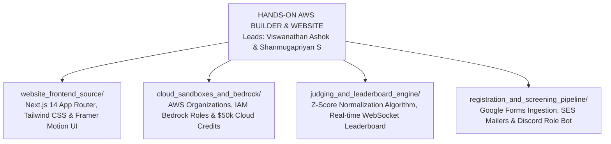

# KAIROS 2027 (Grand Edition) — Hands-On AWS Builder & Website Workspace

> **Domain:** Full-Stack Web Development, AWS Cloud Infrastructure, Bedrock Sandboxes, Live Scoring Engines & Screening Webhooks  
> **Direct Lead:** **Viswanathan Ashok** (Hands-On Builder Lead, Reg: `44110907`, Phone: `+91 9080809088`, Email: `viswanathanvishal39@gmail.com`)  
> **Technical Co-Lead:** **Shanmugapriyan S** (Technical Team Lead, Reg: `44111257`, Phone: `+91 7550091864`, Email: `shanthemach@gmail.com`)  
> **Executive Review:** **Thenappan T** (President & SBGL, Reg: `44110855`, Phone: `+91 6381801640`)  
> **Governing Standards:** `website/` root documentation & `ANTI-Help/02_AWS_GLOBAL_SBGL_PROGRAM_HANDBOOK_SUMMARY.md`  

---

## 1. Domain Scope & Mandate

The Hands-On AWS Builder & Website vertical is the technical engineering backbone of KAIROS 2027. This team is actively engineering the production web portal (`https://kairos.sistawscc.org`), orchestrating AWS Bedrock sandbox accounts for 100 finalist teams, running the dual-phase applicant screening pipeline, and deploying the real-time Z-score normalized scoring and leaderboard engine.



---

## 2. Technical Stack & Cloud Architecture

```text
+-------------------------------------------------------------------------------------------------------+
|                                    KAIROS 2027 FULL CLOUD STACK                                       |
+-------------------+-----------------------------------------------------------------------------------+
| LAYER             | TECHNOLOGIES & SERVICES DEPLOYED                                                  |
+-------------------+-----------------------------------------------------------------------------------+
| Web Frontend      | Next.js 14 (App Router), TypeScript, Tailwind CSS, Framer Motion, Lucide React    |
| Edge & CDN        | Amazon CloudFront, AWS WAF (Web Application Firewall), Amazon Route 53            |
| Compute / Backend | AWS Lambda (Node.js 20.x / Python 3.12), Amazon API Gateway (REST & WebSockets)   |
| Database & State  | Amazon DynamoDB (Single-table design), Amazon ElastiCache (Redis for Leaderboard)|
| Generative AI Hub | Amazon Bedrock (Anthropic Claude 3.5 Sonnet, Amazon Titan, Meta Llama 3 70B)      |
| Storage & Media   | Amazon S3 (Static assets, participant code zip uploads, resume storage)           |
| Communications    | Amazon SES (Automated registration emails & confirmations)                        |
+-------------------+-----------------------------------------------------------------------------------+
```

---

## 3. Subfolder Directory Map & Deliverables

1. **[`website_frontend_source/`](./website_frontend_source/)**: Frontend architecture, page route manifests, responsive breakpoints, Tailwind color tokens matching our Obsidian-Amber design system, and UI component catalog.
2. **[`cloud_sandboxes_and_bedrock/`](./cloud_sandboxes_and_bedrock/)**: Automated provisioning blueprints for AWS Organizations, Service Control Policies (SCPs) preventing budget overruns, Amazon Bedrock IAM access, and distribution of $50,000+ AWS cloud credit vouchers.
3. **[`judging_and_leaderboard_engine/`](./judging_and_leaderboard_engine/)**: The real-time evaluation portal used by 25+ industry judges and mentors, powered by a mathematical **Z-score normalization algorithm** to eliminate judge bias, with live WebSocket leaderboard streaming.
4. **[`registration_and_screening_pipeline/`](./registration_and_screening_pipeline/)**: Automated applicant ingestion engine pulling from Google Forms webhooks, executing dual-phase filtering (Round 1: 2,000+ $\rightarrow$ Top 250 Semi-Finalists; Round 2: $\rightarrow$ Top 100 Finalists), dispatching confirmation emails via SES, and assigning Discord roles.

---

## 4. Engineering Standards & Zero Downtime SLA
- **Test Coverage:** All backend Lambda routes must have automated Jest/PyTest suites with >85% branch coverage.
- **Git Branching Strategy:** `main` (Production - auto-deploys via AWS Amplify/CodePipeline), `staging` (Internal testing), `feature/*` (Individual squad branches). Direct commits to `main` are strictly blocked.
- **High Concurrency Target:** The registration and live leaderboard endpoints must sustain **10,000 requests per second (RPS)** without latency exceeding 250ms.
