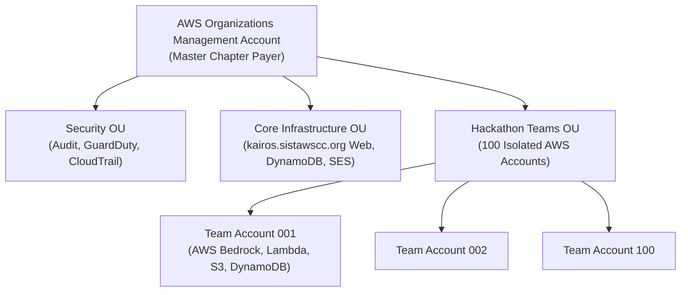

# Cloud Sandboxes & AWS Bedrock Provisioning Specification

> **Subfolder:** `teams/05_hands_on_aws_builder_and_website/cloud_sandboxes_and_bedrock/`  
> **Direct Lead:** **Shanmugapriyan S** (Technical Lead, Reg: `44111257`, Phone: `+91 7550091864`)  
> **Systems Engineer:** **Viswanathan Ashok** (Hands-On Builder Lead, Reg: `44110907`)  
> **AWS Account Administrator:** **Thenappan T** (President & SBGL, Reg: `44110855`)  

---

## 1. Scope & Mandate

This directory manages the automated cloud infrastructure, AWS Organizations architecture, Service Control Policies (SCPs), budget alerts, and AWS Bedrock model quotas provisioned for the **100 Shortlisted Finalist Teams (400–500 Hackers)**.

---

## 2. Multi-Account AWS Architecture

### Sandbox Guardrails:
1. **Budget Cap:** Each team account is capped at **$150 USD** using AWS Budgets with automated SNS alarm triggering a Lambda killer function if spend exceeds $140.
2. **Service Control Policies (SCPs):**
   - **Allowed Services:** Amazon Bedrock, AWS Lambda, Amazon API Gateway, Amazon S3, Amazon DynamoDB, Amazon Cognito, Amazon CloudFront.
   - **Blocked Services:** Expensive GPU EC2 instances (`p4d`, `g5` 8xlarge), cryptocurrency mining ports, unauthorized VPC peering.
   - **Region Lock:** Strictly constrained to `us-east-1` (N. Virginia) and `ap-south-1` (Mumbai).

---

## 3. Foundation Models Enabled on AWS Bedrock
- **Anthropic Claude 3.5 Sonnet:** For agentic tool-use, code synthesis, and multi-modal reasoning.
- **Amazon Titan Text Premier / Embeddings v2:** For vector RAG search and document embeddings.
- **Meta Llama 3 70B Instruct:** For open-weights foundational tasks.

---

## 4. Who Fills What (Accountability)

| Task | Lead | Deadline | Status |
|---|---|:---:|:---:|
| **AWS Organizations Tree & Terraform Scripts** | Shanmugapriyan S | Dec 01, 2026 | Scripted |
| **AWS Bedrock Model Access Quota Escalation** | Thenappan T | Dec 15, 2026 | AWS Granted |
| **Automated IAM Credential Dispatch via SES** | Viswanathan Ashok | Jan 20, 2027 | Automated |
| **Real-Time Cost Monitoring during 48H Sprint** | Cloud Ops Squad | Jan 22–24, 2027 | Live Roster |
| **Post-Event Account Decommissioning & Scrap** | Shanmugapriyan S | Jan 27, 2027 | Scheduled |
