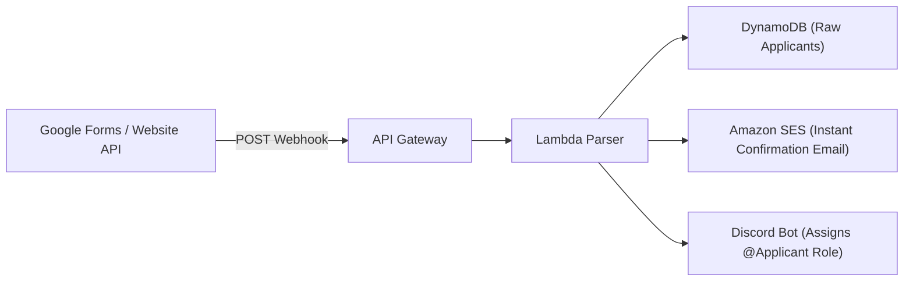

# Registration & Screening Pipeline Specification

> **Subfolder:** `teams/05_hands_on_aws_builder_and_website/registration_and_screening_pipeline/`  
> **Direct Lead:** **Viswanathan Ashok** (Hands-On Builder Lead, Reg: `44110907`)  
> **Screening Architect:** **Shanmugapriyan S** (Technical Lead, Reg: `44111257`)  
> **Admissions Incharge:** **Thenappan T** (President & SBGL, Reg: `44110855`)  

---

## 1. Scope & Mandate

This folder directs the automated data ingestion, applicant verification, and dual-phase quality filtering system handling **2,000+ national student applicant teams**.

---

## 2. The 2-Tier Screening Architecture

```text
[PHASE 0: FREE REGISTRATION VIA WEB / GOOGLE FORMS]
│ • 2,000+ Teams submit Abstract, Architecture Diagram, GitHub & LinkedIn profiles
│ • Webhook listener auto-ingests data into Amazon DynamoDB
▼
[TIER 1: ROUND 1 ONLINE QUALIFIER (JAN 02–04, 2027)]
│ • Top 250 Semi-Finalist Teams Selected
│ • 48H Virtual Code Sprint on GitHub
│ • 3-Minute Loom Architecture Video Walkthrough
│ • 7-Minute Virtual Jury Grilling via 10 Parallel Google Meet Rooms
▼
[TIER 2: ON-CAMPUS 48H GRAND FINALE (JAN 22–24, 2027)]
  • TOP 100 ELITE TEAMS (TEAMS OF 4–6, ~400–600 HACKERS) SHORTLISTED
  • Issued Official University Invitation & Travel Passes (Direct Venue Reporting on Event Day)
  • 100% Free Full-Board Hospitality & Developer Swag Kits
```

---

## 3. Webhook & Automation Workflow



---

## 4. Who Fills What (Accountability)

| Task | Responsible Lead | SLA / Deadline | Status |
|---|---|:---:|:---:|
| **Google Forms & API Ingestion Hook** | Viswanathan Ashok | Oct 10, 2026 | Live |
| **Plagiarism & Abstract Screening Filter** | Shanmugapriyan S | Dec 16–22, 2026 | Scheduled |
| **Semi-Finalist Shortlist Email Blast** | Admissions Squad | Dec 24, 2026 | SES Template |
| **Virtual Evaluation Room Scheduling** | Technical Media Squad | Dec 28, 2026 | Google Meet |
| **Top 100 Finalist Notification Blast** | Thenappan T | Jan 06, 2027 | Confirmed |
