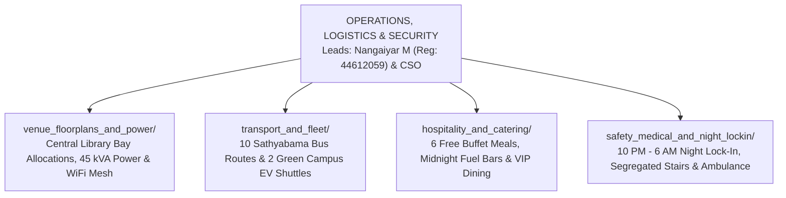

# KAIROS 2027 (Grand Edition) — Operations, Logistics & Security Workspace

> **Domain:** Venue Floorplans, Power Grid Distribution, Bus Fleet & Campus EV Transit, Free Hospitality & Catering, 24/7 Night Security & Medical  
> **Direct Lead:** **Nangaiyar M** (Community & Events Lead, Reg: `44612059`, Phone: `+91 8754976892`, Email: `nangaiyarmuthkrishnan@gmail.com`)  
> **Security & Jury Head:** **Chief Safety Officer (CSO)**  
> **Apex Executive Authority:** **Thenappan T** (President & SBGL, Reg: `44110855`, Phone: `+91 6381801640`)  
> **Faculty Liaison:** **Dr. K. Ashok Kumar** (Dept. of CSE)  

---

## 1. Domain Scope & Mandate

The Operations, Logistics & Security vertical is responsible for the physical life-support, transport, venue infrastructure, and safety of 500+ attendees over 48 continuous hours.

This vertical executes:
- Transforming the Central Library Complex into high-density hackathon bays for 100 teams.
- Routing 45 kVA continuous electrical power and 40 industrial power strips with dual diesel generator failover.
- Running 10 Sathyabama College Bus routes across Chennai and 2 Campus EV Buggy shuttles.
- Delivering 100% free full-board catering: 6 buffet meals, evening high teas, and 01:30 AM midnight pizza/coffee drops.
- Enforcing the strict **10:00 PM – 06:00 AM Night Lock-In** and segregated stairwells for male and female hackers.

---

## 2. Workforce Shift System (8-Hour Rotations)

To prevent volunteer burnout and ensure 100% operational alertness throughout the 48-hour continuous hackathon:
- **Shift 1 (Day Prime):** 08:00 AM – 04:00 PM (35 volunteers on ground)
- **Shift 2 (Evening Sprint):** 04:00 PM – 12:00 AM (35 volunteers on ground)
- **Shift 3 (Graveyard Fuel & Security):** 12:00 AM – 08:00 AM (25 volunteers on ground + Campus Security)
- **Shift Handover Protocol:** 15-minute overlap briefing at Central Library Ground Operations Desk.

---

## 3. Subfolder Directory Map & Deliverables

1. **[`venue_floorplans_and_power/`](./venue_floorplans_and_power/)**: Central Library bay layout blueprints, seating charts for 100 teams, power extension routing, and Wi-Fi access point distribution.
2. **[`transport_and_fleet/`](./transport_and_fleet/)**: Timetables, route stops, driver contacts, and emergency escorts for 10 Sathyabama buses and 2 Campus EV shuttles.
3. **[`hospitality_and_catering/`](./hospitality_and_catering/)**: 6 grand buffet menus, midnight pizza/energy snack ordering schedules, water can replenishment logs, and VIP jury lounge dining.
4. **[`safety_medical_and_night_lockin/`](./safety_medical_and_night_lockin/)**: Campus gate pass protocols, segregated boys/girls mess stairwell wardens, 24/7 Apollo clinic station, and standby ambulance procedures.
