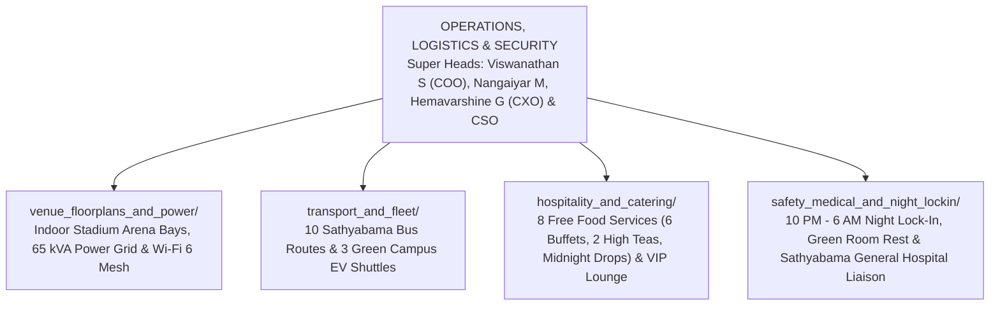

# KAIROS 2027 (Grand Edition) — Operations, Logistics & Security Workspace

> **Domain:** Venue Infrastructure, 65 kVA Power Grid, Bus Fleet & Campus EV Transit, 8-Service Free Catering, 24/7 Night Security & Medical  
> **Operations & Logistics Super Head:** **Viswanathan S** (COO) & **Nangaiyar M** (Community & Events Lead, Reg: `44612059`, Phone: `+91 8754976892`, Email: `nangaiyarmuthkrishnan@gmail.com`)  
> **Hospitality & Experience Super Head:** **Hemavarshine G** (CXO)  
> **Safety, Security & Discipline Head:** **Chief Safety Officer (CSO)**  
> **Apex Executive Authority:** **Thenappan T** (President & SBGL, Reg: `44110855`, Phone: `+91 6381801640`)  
> **Faculty Liaison:** **Dr. K. Ashok Kumar** (Dept. of CSE)  

---

## 1. Domain Scope & Mandate

The Operations, Logistics & Security vertical is responsible for the physical life-support, transport, venue infrastructure, and safety of 500+ attendees (100 finalist teams / 450–600 hackers + 106 student organizers + 25 judges) over 48 continuous hours.

Following institutional approval and empirical benchmarks from Vexora'26 ACM Hackathon, the primary venue is the **Sathyabama Indoor Stadium (Indoor Auditorium)** (~2,500 seats capacity).

This vertical executes:
- Transforming the Sathyabama Indoor Stadium arena floor into high-density hackathon bays for 100 teams across 5 technical tracks.
- Routing a **65 kVA** balanced three-phase electrical power grid with 100–120 heavy-duty spike-protected extension boards, backed by dual 125 kVA auto-synchronized diesel generators (< 10ms failover).
- Running 10 Sathyabama College Bus routes across Chennai and 3 Campus EV Buggy shuttles for continuous transit.
- Delivering 100% free full-board catering across **8 food services** (6 major buffet meals + 2 evening high teas + 01:30 AM midnight pizza/energy fuel drops) plus continuous 24/7 coffee/tea and mineral water.
- Enforcing the strict **10:00 PM – 06:00 AM Night Lock-In**, Green Room 1 Female Rest Sanctuary, Upper Bleachers quiet nap pods, and 24/7 on-campus medical standby via Sathyabama General Hospital.

---

## 2. Workforce Shift System (8-Hour Rotations)

To prevent volunteer burnout and ensure 100% operational alertness throughout the 48-hour continuous hackathon:
- **Shift 1 (Day Prime):** 08:00 AM – 04:00 PM (35 volunteers on ground)
- **Shift 2 (Evening Sprint):** 04:00 PM – 12:00 AM (35 volunteers on ground)
- **Shift 3 (Graveyard Fuel & Security):** 12:00 AM – 08:00 AM (25 volunteers on ground + Campus Security)
- **Shift Handover Protocol:** 15-minute overlap briefing at Stadium Foyer Operations NOC.

---

## 3. Subfolder Directory Map & Deliverables

1. **[`venue_floorplans_and_power/`](./venue_floorplans_and_power/)**: Sathyabama Indoor Stadium arena floorplans, seating charts for 100 teams across Sectors Alpha–Echo, 65 kVA electrical grid distribution, cable ramp safety, and Wi-Fi 6 access point topology.
2. **[`transport_and_fleet/`](./transport_and_fleet/)**: Timetables, route stops, driver contacts, and emergency escorts for 10 Sathyabama buses across Chennai and 3 Campus EV shuttles.
3. **[`hospitality_and_catering/`](./hospitality_and_catering/)**: 8 complimentary food services (6 full buffets, 2 high teas, 2 midnight pizza drops), water canister logistics, and Backstage Green Room 2 VIP jury lounge dining.
4. **[`safety_medical_and_night_lockin/`](./safety_medical_and_night_lockin/)**: Campus gate pass protocols, Green Room 1 female rest sanctuary, 10 PM – 6 AM lock-in enforcement, 24/7 on-campus health desk, and Sathyabama General Hospital standby ambulance procedures.
