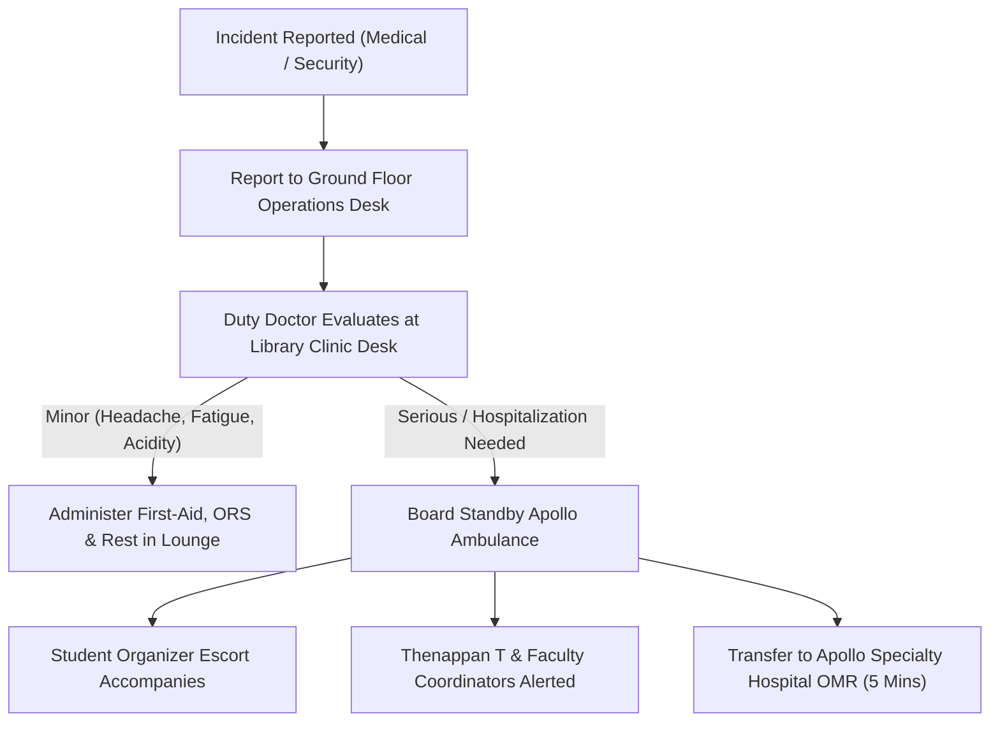

# KAIROS 2027 — Night Security Standard Operating Procedure (SOP) & Medical Incident Log

> **Direct Lead:** Chief Safety Officer (CSO)  
> **Medical Incharge:** Sathyabama Campus Health Center & Apollo Clinic  

---

## 1. Incident Command Flowchart (Medical & Security)

---

## 2. Night Security Patrol Roster (10:00 PM – 06:00 AM)

| Shift Time | Patrol Sector | Assigned Guards & Student Leads | Checkpoints Checked |
|:---:|---|---|---|
| **22:00 – 00:00** | Perimeter Doors & Entry Porch | 2 Security Guards + Squad Lead 1 | Verify all doors locked, smart badge audit |
| **00:00 – 02:00** | 2nd Floor Hack Bays (LH 1–3) | 2 Student Organizers + Floor Warden | Check air conditioning, power strips, hydration |
| **02:00 – 04:00** | Rest Lounges & Stairwells | Lady Warden (South) + Guard (North) | Verify strict segregation and quiet hours |
| **04:00 – 06:00** | Foyer, Restrooms & Main Porch | 2 Security Guards + Squad Lead 2 | Prepare venue unlocking at 06:00 AM |

---

## 3. Emergency Contact Numbers Speed Dial

- **Apex Organizer (Thenappan T):** `+91 6381801640`
- **Faculty Coordinator (Dr. Balapriya .S):** `+91 9444101234`
- **Campus Chief Security Officer:** `044-24503100` / `Ext: 555`
- **SIST Campus Health Center:** `044-24503150`
- **Apollo Specialty Hospital (OMR Kandanchavadi):** `044-24961111` / Ambulance: `1066`
- **Semmancheri Police Station:** `044-24500100`
