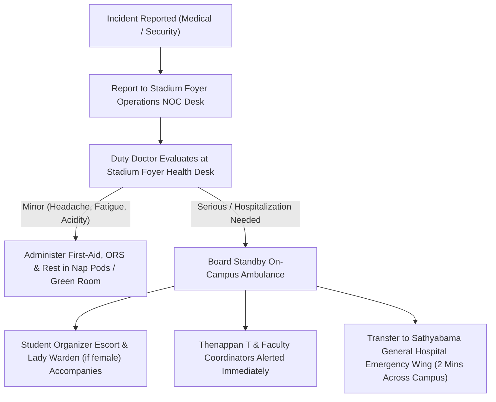

# KAIROS 2027 — Night Security Standard Operating Procedure (SOP) & Medical Incident Log

> **Direct Lead:** **Shaik Khaja Mohiddin** (Safety & Governance Lead)  
> **Medical Incharge:** Sathyabama General Hospital (On-Campus Emergency Center) & Apollo Specialty Hospital OMR  

---

## 1. Incident Command Flowchart (Medical & Security)

---

## 2. Night Security Patrol Roster (10:00 PM – 06:00 AM)

| Shift Time | Patrol Sector | Assigned Guards & Student Leads | Checkpoints Checked |
|:---:|---|---|---|
| **22:00 – 00:00** | Stadium Arena Perimeter Doors & Foyer | 2 Campus Guards + Ops Squad Lead 1 | Verify all arena perimeter doors secured, badge audit |
| **00:00 – 02:00** | Arena Floor Hack Bays (Sectors Alpha–Echo) | 2 Student Organizers + Floor Warden | Check ventilation, power strips, hydration, laptop security |
| **02:00 – 04:00** | Green Room 1 Sanctuary & Upper Bleachers | Lady Warden (Green Room) + Guard (Bleachers) | Verify strict female sanctuary protection & quiet hours |
| **04:00 – 06:00** | Foyer Porch, Restrooms & Portico | 2 Campus Guards + Ops Squad Lead 2 | Prepare venue unlocking at 06:00 AM, clean water check |

---

## 3. Emergency Contact Numbers Speed Dial

- **Apex Executive (Thenappan T):** `+91 6381801640`
- **Faculty Coordinator (Dr. Balapriya .S):** `+91 9444101234`
- **Campus Chief Security Officer:** `044-24503100` / `Ext: 555`
- **Sathyabama General Hospital Emergency:** `044-24503150`
- **Apollo Specialty Hospital (OMR Kandanchavadi):** `044-24961111` / Ambulance: `1066`
- **Semmancheri Police Station:** `044-24500100`

