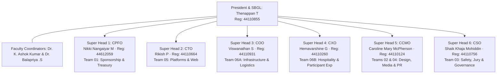
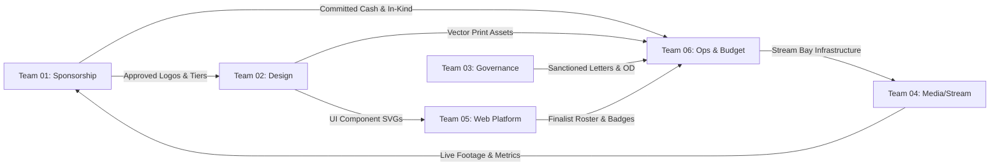
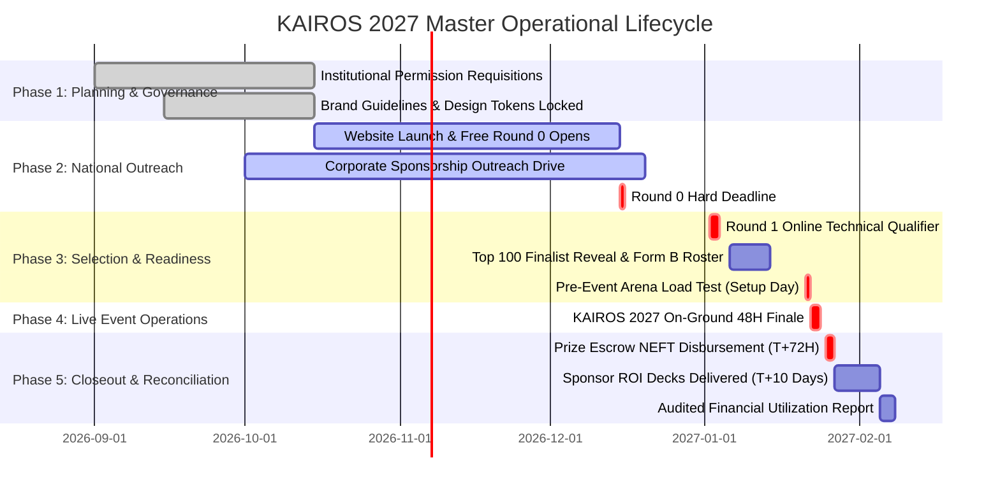

# KAIROS 2027 — Multi-Team Workspace Hub & Master Operating System

**Document Reference:** `teams/README.md`  
**Host Entity:** AWS Student Builder Group (AWS SBG) — SIST Chapter  
**Sponsoring Institution:** Sathyabama Institute of Science and Technology (Deemed to be University), Chennai – 600119  
**Executive Authority:** President Thenappan T (Register No: `44110855`) & The Executive Leadership Council  
**Faculty Coordinators:** Dr. K. Ashok Kumar & Dr. Balapriya .S (Department of CSE, SIST)  
**Governing Standards (Executive Planning Framework):** `DOC-00 (Master Brief)` · `DOC-08 (Operations & Shift Roster)` · `DOC-13 (Core Team Primer)` · `DOC-18 (Workforce Deployment)` · `DOC-20 (Indoor Stadium Transition Plan)`  
**Event Window:** January 22 – 24, 2027 (48 Continuous Hours)  
**Official Venue:** Sathyabama Indoor Stadium (Indoor Auditorium), Sathyabama Campus  
**Working Operational Capital:** ₹3,50,000 – ₹4,00,000 Liquid Sponsorship Escrow  
**Pure Cash Prize Pool:** **₹1,75,000 Pure Liquid Cash Escrow** + $50,000+ AWS Cloud Credits  
**Participant Model:** **100% FREE — ZERO ENTRY FEE** (Meritocracy intake across India)  
**Workforce Scale:** 106 Student Organizers Across 6 Specialized Super Head Divisions  
**Status:** `CONFIRMED MASTER OPERATING STANDARD`  

---

## 1. Executive Operating Model & Incident Command System (ICS)

KAIROS 2027 deploys a battle-tested **Incident Command System (ICS)** structure. Every organizing domain has a single accountable Super Head reporting directly to **President Thenappan T**, backed by faculty oversight from Dr. K. Ashok Kumar and Dr. Balapriya .S.



### 1.1 Division Ownership & Functional Roster

| Team Code | Division Name & Workspace Directory | Super Head / Accountable Lead | Core Mandate & Primary Outputs |
|:---:|---|---|---|
| **01** | [**Sponsorship & Corporate Partnerships**](./01_sponsorship_and_partnerships/README.md) | **Nikki Nangaiyar M** (CPFO, Reg: `44612059`) | Enterprise fundraising, tier contracting (₹2.0L Title to ₹25k Track), CRM pipeline, sponsor deliverable fulfillment, and ROI reporting. |
| **02** | [**Design & Creative Assets**](./02_design_and_creative_assets/README.md) | **Rikish B** (Design Lead) & **Caroline McPherson** (CCMO) | Master visual identity, 50×10ft stadium backdrop, 12×8ft LED video loop, 16 standees, CR80 smart badges, apparel kits, and social assets. |
| **03** | [**Documentation & Institutional Compliance**](./03_documentation_and_compliance/README.md) | **Shaik Khaja Mohiddin** (CSO) & **Hemavarshine S** | 7 official university permission letters, participant rulebooks, 100% student IP undertakings, sprint MoMs, and audit archives. |
| **04** | [**Media, PR & Live Broadcast**](./04_media_pr_and_broadcast/README.md) | **Caroline Mary McPherson** (CCMO) & **Harshith Raj S** | National press releases, 120+ campus ambassador network, 48-hour continuous multicam live stream, and official 4K cinematic aftermovie. |
| **05** | [**Hands-On AWS Builder & Website**](./05_hands_on_aws_builder_and_website/README.md) | **Rikish P** (CTO) & **Viswanathan Ashok** | Next.js 14 web portal (`kairos.sathyabama.ac.in`), AWS Bedrock model sandboxes, Devfolio webhooks, and Z-score judging engine. |
| **06** | [**Operations, Logistics & Security**](./06_operations_logistics_and_security/README.md) | **Viswanathan S** (COO) & **Hemavarshine G** (CXO) | Sathyabama Indoor Stadium arena floor bays, 65 kVA power grid, 8-meal buffet catering, 10 college buses, 3 EV buggies, and night lock-in. |

---

## 2. Cross-Team RACI Responsibility Matrix

To eliminate overlapping authority and prevent tasks from falling between divisions, the following **RACI Matrix** establishes single-point accountability for recurring hackathon milestones:

> **RACI Definitions:**  
> • **A (Accountable):** The ONE role answerable for the correct, thorough completion of the deliverable.  
> • **R (Responsible):** The role(s) who actively do the work to achieve the deliverable.  
> • **C (Consulted):** Domain experts whose opinions are sought prior to a decision or action.  
> • **I (Informed):** Roles kept updated on progress, milestones, or completion.

```
+------------------------------------+-------+-------+-------+-------+-------+-------+
| Milestone / Recurring Workstream   | TM 01 | TM 02 | TM 03 | TM 04 | TM 05 | TM 06 |
|                                    | (CPFO)|(Design|(Doc/Gov|(Media)| (CTO) | (COO) |
+------------------------------------+-------+-------+-------+-------+-------+-------+
| Corporate Sponsorship MoU & Funds  |   A   |   C   |   C   |   I   |   I   |   C   |
| Stage LED Wall & Banner Printing   |   C   |   A   |   I   |   C   |   I   |   R   |
| University Permissions & Approvals |   I   |   I   |   A   |   I   |   I   |   C   |
| National Marketing & Ambassador PR |   C   |   R   |   I   |   A   |   C   |   I   |
| Web Portal & Git Telemetry Webhook |   I   |   C   |   C   |   C   |   A   |   C   |
| Stadium 65 kVA Power & Table Grid  |   I   |   C   |   I   |   I   |   C   |   A   |
| 8 Food Services & Midnight Snacks  |   C   |   I   |   I   |   I   |   I   |   A   |
| Checkpoint 1 & 2 Judging Logistics |   C   |   I   |   R   |   I   |   R   |   A   |
| 48-Hour Multicam Stream Broadcast  |   C   |   C   |   I   |   A   |   C   |   R   |
| Pure Cash Prize Escrow NEFT Payout |   A   |   I   |   R   |   I   |   C   |   I   |
| 10-Slide Sponsor ROI Report & Deck |   A   |   R   |   C   |   R   |   C   |   C   |
+------------------------------------+-------+-------+-------+-------+-------+-------+
```

---

## 3. Comprehensive Cross-Team Handoff Matrix

Every inter-team transition must meet explicit acceptance criteria before work is considered successfully handed off:



### 3.1 Cross-Team Handoff Specifications

| Initiating Team | Receiving Team | Transferred Artifact / Data | Hand-off Milestone | Minimum Acceptance Criteria | Downstream Fallback if Incomplete |
|:---|:---|---|:---:|---|---|
| **Team 01 (Sponsorship)** | **Team 02 (Design)** | High-res vector sponsor logos (`.svg` / `.ai`) and branding guidelines. | T-14 Days | Verified vector asset with transparent background and clear zone specs. | Use standard typographic brand name; alert CPFO. |
| **Team 01 (Sponsorship)** | **Team 06 (Ops)** | Sponsor on-site requirements (booth dimensions, electrical drops, VIP passes). | T-7 Days | Written summary of booth headcount, equipment power draw, and arrival timing. | Standard 10×10ft pod with single 6A spike board provided. |
| **Team 02 (Design)** | **Team 06 (Ops)** | Print-ready PDF files for banners, standees, and backdrop. | T-5 Days | CMYK color profile, 300 DPI, correct bleed margins, vendor sign-off. | Vendor printing halted; emergency review called. |
| **Team 03 (Compliance)** | **Team 06 (Ops)** | Stamped institutional approval letters (Letters 1 to 7). | T-10 Days | Signed approval from Registrar, Dean, Estate Office, Transport, and Mess. | Physical venue setup cannot commence on campus. |
| **Team 05 (Platform)** | **Team 06 (Ops)** | Finalist check-in roster with team codes, food preferences, and swag sizes. | T-3 Days | 100 teams verified, zero missing contact numbers, CSV/JSON format. | Check-in reverts to physical photo ID inspection. |
| **Team 06 (Ops)** | **Team 04 (Media)** | Arena stream bay setup: dedicated 1 Gbps LAN line, power drop, camera risers. | T-1 Day (20:00) | Speedtest confirms >50 Mbps continuous upload; zero packet loss. | Stream switches to secondary 5G cellular bonded router. |
| **All Teams** | **Team 01 (Sponsorship)** | Photographic evidence of sponsor brand delivery, stage loop, and booth engagement. | T+48 Hours | 4K resolution photos showing banner placements and footfall. | CPFO delays delivery of customized sponsor ROI deck. |

---

## 4. 48-Hour Event Lifecycle & Milestone Roadmap

All team deliverables are structured into five synchronized operational phases:



### 4.1 Phase Milestones & Team Deadlines

1. **Phase 1: Foundation & Governance (T-120 to T-60 Days):**
   * Institutional Letters 1–7 submitted to Sathyabama University administration.
   * Brand guidelines locked; circular evergreen logo finalized.
   * Sponsorship deck, pricing tiers, and outreach pipeline launched.
2. **Phase 2: National Outreach & Screening (T-60 to T-14 Days):**
   * Next.js web portal live at `kairos.sathyabama.ac.in`.
   * Round 0 national applications open (Target: 2,000+ teams).
   * 120+ Campus Ambassador network activated nationwide.
3. **Phase 3: Final Readiness & Staging (T-14 to T-1 Days):**
   * Top 250 Online Semi-Finalists evaluated during Round 1 (Jan 02–04).
   * Top 100 Finalists confirmed via Form B; bus routes locked.
   * **Setup Day (Jan 21):** Sathyabama Indoor Stadium 65 kVA power load test, Wi-Fi 6 deployment, backdrop mounting.
4. **Phase 4: Live Arena Execution (Event Window: Jan 22–24):**
   * 48 hours continuous hacking under 3 rotating 8-hour volunteer shifts.
   * Checkpoint 1 (Architecture), Checkpoint 2 (Live Code), Round 3 (Stage Demos).
   * 8 complimentary buffet food services and midnight energy fuel drops.
5. **Phase 5: Financial & Operational Closeout (T+1 to T+14 Days):**
   * ₹1,75,000 pure cash prize escrow disbursed via NEFT within 72 hours (by Jan 27).
   * 10-slide customized Sponsor ROI decks delivered within 10 days (by Feb 05).
   * Audited financial utilization report submitted to University Registrar within 14 days (by Feb 08).

---

## 5. Operating Cadence, Meeting Rules & Escalation Ladder

### 5.1 Meeting Structure (Zero Needless Overhead)
* **Weekly Core Council Sprint (Sundays 19:00 – 20:00 IST):** Attended by President, Faculty Coordinators, and all 6 Super Heads. Focus strictly on blockers, sponsor pipeline velocity, and handoff deadlines.
* **Squad Standup (Tuesdays / Thursdays 21:00 – 21:20 IST):** 20-minute rapid async/sync standup within individual squads to clear Jira/GitHub tasks.
* **On-Ground Event Briefings (Every 8 Hours during Jan 22–24):** Mandatory 15-minute shift overlap briefing in the Central Arena War Room between departing and arriving cohorts.

### 5.2 3-Minute Incident Escalation Ladder
Any operational blocker, medical anomaly, or safety concern must follow the standard 3-minute escalation path:

```text
[Step 1: Floor Volunteer detects issue]
       │
       ▼ (If unresolved in < 3 minutes)
[Step 2: Table Marshal contacts Squad Lead over UHF Radio]
       │
       ▼ (If unresolved in < 10 minutes or impacts multiple teams)
[Step 3: Squad Lead alerts Super Head in Central Arena War Room]
       │
       ▼ (If Tier 3 Critical: Medical, Power Blackout, Security)
[Step 4: Super Head alerts President Thenappan T & Faculty Coordinator instantly]
```

---

## 6. Complete Team Workspaces & Document Catalog

Navigate to specific team workspaces for execution runbooks, production assets, and schemas:

```
teams/
├── 01_sponsorship_and_partnerships/
│   ├── README.md                                    # Master Sponsorship Operating System
│   ├── 00_sponsorship_source_of_truth.md            # Canonical Pricing, Tiers & Escrow Model
│   ├── 01_sponsorship_strategy_and_package_matrix.md# Tier Rights, Bounties & Quotas
│   ├── 02_prospecting_outreach_and_negotiation_playbook.md # Email Scripts, Objections & Closing
│   ├── 03_pitch_deck_and_sponsor_meeting_kit.md     # Meeting Structure & Demo Kit
│   ├── 04_proposal_contracting_and_approval_workflow.md # University MoU & Invoicing Path
│   ├── 05_finance_controls_and_pipeline_review.md   # Escrow, Receipts & CRM Governance
│   ├── 06_fulfillment_assets_and_proof_of_performance.md # Proof-of-Performance Tracking
│   ├── 07_post_event_roi_and_renewal.md             # 10-Slide ROI Deck & Kairos 2028 Bridge
│   ├── company_leads_tracker/                       # Pipeline CRM & Meeting Notes
│   ├── pitch_decks/                                 # Master Slide Architecture
│   ├── signed_mous_and_contracts/                   # Reusable MoU & Letter Templates
│   └── sponsor_deliverables_and_assets/             # Intake Specs & Delivery Checklists
│
├── 02_design_and_creative_assets/
│   ├── README.md                                    # Design System & Creative Production Hub
│   ├── apparel_and_merchandise/                     # T-Shirts, Hoodies & Sizing Matrices
│   ├── badges_and_lanyards/                         # CR80 Smart NFC Badge Specs
│   ├── brand_identity_and_logos/                    # Vector Hourglass & Logo Lockups
│   ├── certificates_and_awards/                     # 11 Canonical Trophy & Award Specs
│   ├── social_media_creatives/                      # 4:5 Instagram Feed & 9:16 Story Kits
│   ├── stage_and_venue_banners/                     # 50×10ft Mega Backdrop & LED Video Wall
│   └── standees/                                    # 16 High-Impact Venue Standees Tracker
│
├── 03_documentation_and_compliance/
│   ├── README.md                                    # Institutional Governance & Legal Records
│   ├── official_letters/                            # Letters 1 to 7 Status Compendium
│   ├── participant_rules_and_agreements/            # 100% Student IP & Code of Conduct
│   └── reports_and_minutes/                         # Sprint MoM & Executive Retrospective
│
├── 04_media_pr_and_broadcast/
│   ├── README.md                                    # National PR, Ambassadorship & Broadcast
│   ├── broadcast_and_streaming/                     # 48H Multicam Live Stream Cue Sheet
│   ├── campus_ambassador_toolkit/                   # 120+ CA WhatsApp Broadcast Scripts
│   ├── press_releases_and_articles/                 # National Hackathon Launch Press Release
│   └── social_media_schedules/                      # Multi-Week Social Calendar & Hooks
│
├── 05_hands_on_aws_builder_and_website/
│   ├── README.md                                    # Next.js 14 Portal & Cloud Architecture
│   ├── cloud_sandboxes_and_bedrock/                 # AWS Bedrock Starter Kit & IAM Limits
│   ├── judging_and_leaderboard_engine/              # Z-Score Normalization Algorithm & API
│   ├── registration_and_screening_pipeline/         # Devfolio Webhook & Intake Schemas
│   └── website_frontend_source/                     # UI Component Library & CSS Tokens
│
└── 06_operations_logistics_and_security/
    ├── README.md                                    # Sathyabama Indoor Stadium Operations Hub
    ├── hospitality_and_catering/                    # 8-Meal Buffet Plan & Fuel Stations
    ├── safety_medical_and_night_lockin/             # 10 PM - 6 AM Curfew & Hospital SOP
    ├── transport_and_fleet/                         # 10 College Buses & 3 EV Buggies Log
    └── venue_floorplans_and_power/                  # Arena Bays A-D & 65 kVA Power Grid
```

---

## 7. Reusable Cross-Team Operating Templates

### 7.1 Template 1: Weekly Squad Status Update

```markdown
### [SQUAD NAME] — Weekly Sprint Status Update
**Reporting Period:** [DD/MM/YYYY] to [DD/MM/YYYY]  
**Accountable Lead:** [Name / Role / Reg No]  
**Division Super Head:** [Super Head Role]  

#### 1. Highlights & Completed Deliverables
- [Deliverable 1]: Completed on [Date]; verified against [Acceptance Standard].
- [Deliverable 2]: Handoff completed to [Receiving Team]; confirmed by [Receiver Name].

#### 2. In-Progress Workstreams (Current Sprint)
- [Task 1]: [Status %] · Target Due: [Date] · Blockers: [None / Explain].
- [Task 2]: [Status %] · Target Due: [Date] · Dependencies: [Explain].

#### 3. Critical Blockers & Escalations Needed
- [Blocker Description]: Requires decision from [Role] by [Date] to prevent schedule slip.

#### 4. Upcoming Key Milestones (Next 7 Days)
- [Milestone 1]: Target completion date [DD/MM/YYYY].
```

---

### 7.2 Template 2: Action Item & Decision Register

```markdown
| Action ID | Action Description | Accountable Role | Working Squad | Target Due Date | Dependency / Prerequisite | Verified Status |
|:---:|---|---|---|:---:|---|:---:|
| **ACT-01** | `[TASK DESCRIPTION]` | `[ROLE PLACEHOLDER]` | `[SQUAD]` | `[DD/MM/YYYY]` | `[PREREQUISITE]` | `OPEN / DONE` |
| **ACT-02** | `[TASK DESCRIPTION]` | `[ROLE PLACEHOLDER]` | `[SQUAD]` | `[DD/MM/YYYY]` | `[PREREQUISITE]` | `OPEN / DONE` |
```

---

### 7.3 Template 3: Cross-Team Handoff & Acceptance Protocol

```markdown
### Official Cross-Team Handoff Form
**Handoff Reference ID:** `HO-[INITIATOR]-[RECEIVER]-[YYYYMMDD]`  
**Initiating Team & Lead:** `[Team Name]` — `[Lead Name / Role]`  
**Receiving Team & Lead:** `[Team Name]` — `[Lead Name / Role]`  
**Date of Transmission:** `[DD/MM/YYYY]`  

#### 1. Description of Handed-Over Asset / Data
- **Asset Name:** `[Asset / Database / File Path]`
- **Format / Platform:** `[Figma / SVG / CSV / GitHub Repo / Signed PDF]`
- **Direct Link / File Location:** `[Relative Markdown Link]`

#### 2. Acceptance Criteria Checklist (Must be checked by Receiver)
- [ ] Asset meets the required technical specifications (DPI, resolution, format, schema).
- [ ] No missing fields, broken dependencies, or unverified claims.
- [ ] Compliant with KAIROS brand guidelines and data privacy policies.

#### 3. Formal Acknowledgment & Sign-Off
- **Receiver Status:** `[ACCEPTED / REJECTED WITH COMMENTS]`
- **Receiver Notes:** `[Enter any feedback or required revisions]`
- **Confirmed By:** `[Receiver Name / Role]` · **Date:** `[DD/MM/YYYY]`
```

---

### 7.4 Template 4: Rapid Incident & Blameless Post-Mortem Record

```markdown
### KAIROS 2027 Incident & Escalation Record
**Incident ID:** `INC-[YYYYMMDD]-[001]`  
**Severity Tier:** `[TIER 1 (Minor) / TIER 2 (Significant) / TIER 3 (Critical)]`  
**Time of Occurrence:** `[HH:MM IST]` · **Time of Resolution:** `[HH:MM IST]`  
**Venue Location:** `[Arena Bay A-D / Stage / Foyer / Mezzanine / Mess / Bus]`  

#### 1. Incident Description
- **What happened:** `[Concise description of the anomaly or failure]`
- **Who detected it:** `[Role / Call Sign over UHF Radio]`
- **Initial Impact:** `[Number of teams, participants, or systems affected]`

#### 2. Immediate Corrective Action Taken (< 15 Minutes)
- **Actions executed:** `[Step-by-step resolution actions]`
- **Personnel dispatched:** `[Runner / Electrician / Doctor / Lead]`

#### 3. Root Cause Analysis (Blameless System Review)
- **Why did the failure occur:** `[System design flaw, hardware defect, queue bottleneck]`
- **Preventive system change:** `[Operational change to guarantee it cannot happen again]`

#### 4. Review & Governance Sign-Off
- **Logged By:** `[Name / Role]` · **Reviewed By CSO:** `Shaik Khaja Mohiddin (CSO)`
```
