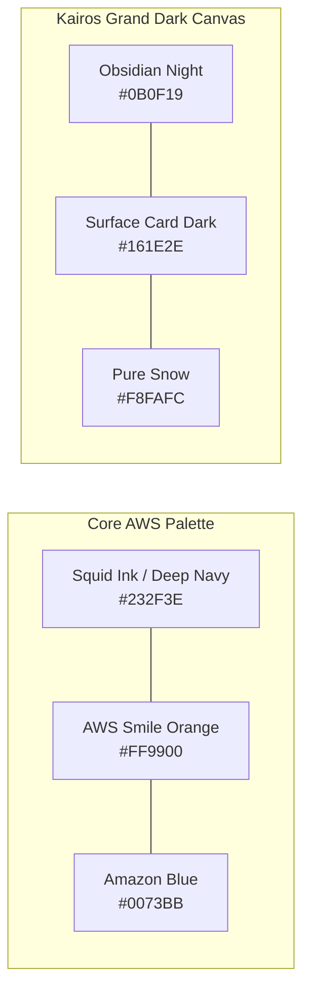
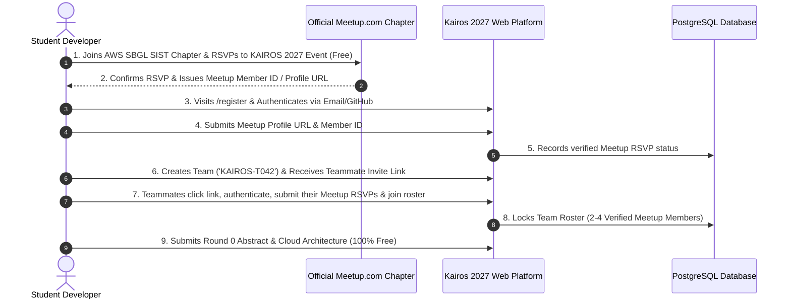
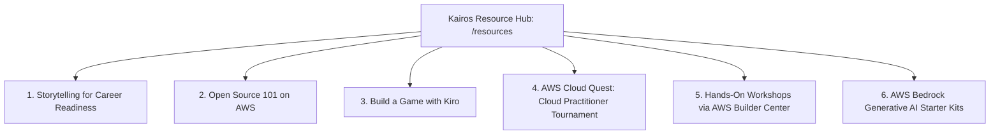

# KAIROS 2027 — AWS Student Builder Group Brand, Leader Library & Event Toolkit Integration Manual

**Authoritative Source:** Directly derived from official AWS Student Builder Group Leader guidelines in `E:\AWS SBGL\Leader Library`  
**Governing Organization:** AWS Student Builder Group (AWS SBGL SIST), Sathyabama Institute of Science and Technology  
**Lead Organizer & Signatory:** Thenappan T, President — AWS SBGL SIST  
**Target Web Domain:** `https://kairos.sbg-sathyabama.ac.in`  
**Official Meetup Chapter:** `https://meetup.com/aws-student-builder-group-sist`  

---

## 1. AWS Student Builder Group Mission & Identity Alignment

As mandated in the *AWS Student Builder Group Leader Handbook (2026)*:
> "AWS Student Builder Group's mission is to create and empower a global community of students to learn, build, and connect with cloud computing, technological advancements, and like-minded individuals."

As Student Builder Group Leaders, Kairos 2027 brings this mission to life on campus by:
1. **Creating a collaborative learning environment** for students to develop skills within AWS Cloud.
2. **Building community and engagement within the AWS Builder Center** and our university chapter on **Meetup.com**.

### 1.1 Mandatory Legal & Co-Branding Disclaimers
Per official AWS SBG Branding Guidelines (Handbook Page 32):
* **Group Representation:** The group must be presented as an official student builder community, never as an internal AWS employee group.
* **Official Website Footer Disclaimer (Mandatory on every page):**
  ```text
  AWS Student Builder Group Sathyabama is an independent student organization supported by the AWS Student Builder Groups program. Amazon Web Services, AWS, and the AWS logo are trademarks of Amazon.com, Inc. or its affiliates.
  ```
* **Official Logo Lockup:** Custom campus branding must combine the official AWS Student Builder Group primary brandmark with the campus name (`Sathyabama Institute of Science and Technology`) positioned at the base, formatted in accordance with the official Brand Asset Generator rules (`https://aws-version-3--assets-generator.netlify.app/`).

---

## 2. Official Brand Visual Tokens (From Leader Library Assets)

### 2.1 Amazon Ember Typography System
The Kairos 2027 website and digital portal strictly employ the official **Amazon Ember** typography suite provided in `E:\AWS SBGL\Leader Library\01- Creative Assets _ Fonts, Icons, Etc_\Fonts`:

| Font Variant | File Source in Leader Library | Web Application Role | CSS Font Family Declaration |
|---|---|---|---|
| **Amazon Ember Display Bold** | `AmazonEmberDisplay_Bd.ttf` | Display Hero (H1), Mega Countdown, Valedictory Winner Titles | `'Amazon Ember Display', 'Space Grotesk', sans-serif` |
| **Amazon Ember Display Heavy**| `AmazonEmberDisplay_He.ttf` | Section Titles, Track Category Headlines | `'Amazon Ember Display', sans-serif; font-weight: 900;` |
| **Amazon Ember Display Medium**| `AmazonEmberDisplay_Md.ttf` | Card Headers (H2/H3), Modal Headers | `'Amazon Ember Display', sans-serif; font-weight: 500;` |
| **Amazon Ember Regular** | `AmazonEmberDisplay_Rg.ttf` | Body Copy, Explanatory Paragraphs, FAQ Answers | `'Amazon Ember', 'Inter', sans-serif; font-weight: 400;` |
| **Amazon Ember Mono Regular** | `AmazonEmberMono_Rg.ttf` | API Endpoints, JSON Schemas, CLI Code Blocks | `'Amazon Ember Mono', 'JetBrains Mono', monospace; font-weight: 400;` |
| **Amazon Ember Mono Bold** | `AmazonEmberMono_Bd.ttf` | Terminal Badges, Team Codes (`KAIROS-T042`), Git Commit Hashes | `'Amazon Ember Mono', monospace; font-weight: 700;` |
| **Amazon Ember Duospace** | `Amazon Ember Duospace.ttf` | Live Leaderboard Telemetry, Metric Values, Z-Scores | `'Amazon Ember Duospace', monospace;` |

---

### 2.2 Official Color System & Brand Tokens



| Token Name | HEX Code | RGB | Brand Application |
|---|:---:|:---:|---|
| **AWS Smile Orange / Amber** | `#FF9900` | `255, 153, 0` | Primary brand accent, CTA buttons, active state glows, winner badges |
| **Squid Ink / Deep Navy** | `#232F3E` | `35, 47, 62` | Secondary headers, navigation card surfaces, terminal backgrounds |
| **Obsidian Dark Canvas** | `#0B0F19` | `11, 15, 25` | Primary background canvas across all public and portal pages |
| **Surface Card Dark** | `#161E2E` | `22, 30, 46` | Glassmorphic card backdrops, form modals, leaderboard table rows |
| **Amazon Blue** | `#0073BB` | `0, 115, 187` | Link states, cloud architecture badge indicators, track metadata |
| **Matrix Green / Success** | `#10B981` | `16, 185, 129` | Verified Meetup RSVP badge, live round status beacon, zero-fee pills |
| **Pure Snow Light** | `#F8FAFC` | `248, 250, 252` | Primary headings, high-contrast labels, white brandmark text |

---

## 3. Mandatory Meetup Integration & Dual-Registration Protocol

As stipulated in the *AWS Student Builder Group Leader Handbook* (Page 26, 51) and *Event Checklist* (Page 1):
> **"Events must be publicized and tracked on Meetup.com. Attendance must be maximized and reflective of your group's size."**

To enforce 100% compliance with AWS Student Builder Group reporting requirements, Kairos 2027 implements a **Meetup-First Dual Registration Architecture**:



### 3.1 Step-by-Step Registration Rules on the Website:
1. **No Entry Fee:** Zero payment gateway exists anywhere in the portal. Registration is 100% free.
2. **Meetup RSVP Verification:**
   * Every team member must provide their **Meetup Member Profile URL** (e.g., `https://www.meetup.com/members/12345678/` or public username).
   * The platform verifies that the profile belongs to a registered member of the official `AWS Student Builder Group — SIST` chapter.
   * A dynamic verification badge `🟢 Meetup RSVP Verified` appears on each member's card.
3. **AWS Builder Center Profile Integration:**
   * In alignment with the Leader Toolkit (Page 1), participants are prompted to provide their **AWS Builder Center Profile URL**.
   * Fosters continuous engagement beyond the hackathon, directly counting toward the club's AWS Builder Center article and community metrics.

---

## 4. Student Content Resource Library Integration (`/resources`)

As provided in the *AWS Student Builder Group Leader Event Toolkit* (Pages 2–4), the Kairos 2027 website includes a dedicated **Resources & Learning Hub** (`/resources`) featuring turnkey AWS educational resources:



### 4.1 Resource Catalog Embedded on Website:
1. **AWS Cloud Quest: Cloud Practitioner Tournament:**
   * 12 free hands-on assignments with architecture diagrams, quizzes, and live competitive tournament mode.
   * Embedded directly on the website as pre-event training for Round 1 Online Qualifier participants.
2. **Storytelling for Career Readiness:**
   * 2-hour interactive module helping students articulate cloud hackathon projects in technical job interviews.
   * Downloadable slide decks and guides in the hacker dashboard.
3. **Build a Game with Kiro:**
   * Turnkey GitHub repository and workshop deck for rapid serverless game prototyping on AWS.
4. **Open Source 101 on AWS:**
   * Core architectural patterns for open-source contribution and cloud deployment.
5. **AWS Bedrock Foundation Model Starter Kits:**
   * Custom starter code (Python/TypeScript) connecting to Claude 3.5 Sonnet, Amazon Titan, and Llama 3 on AWS Bedrock with vector embeddings on OpenSearch Serverless.

---

## 5. Social Media & Brand Asset Compliance

Per official guidelines in the *Leader Handbook* (Pages 33–34):
* **Brand Asset Generator Usage:** All social graphics, stage slides, and promo banners must be generated using the official template:
  * Generator URL: `https://aws-version-3--assets-generator.netlify.app/`
  * Official Template Password: `lets-make-assets`
* **Mandatory Official Hashtags:**
  * `#AWSsbgl`
  * `#StudentsAtAWS`
  * `#StudentsBuildAWS`
  * `#AWSStudentBuilderGroupLeader`
  * `#StudentsBuildOn`
  * `#WomenInStudentBuilderGroups`
* **Official Social Media Handles to Tag:**
  * Tag `@awsdevelopers` on X.
  * Tag `AWS Developers` on LinkedIn.

---

## 6. Post-Event CSAT Reporting & Metric Engine (`/csat`)

Per official Event Toolkit guidelines (Handbook Page 26, 51):
* **Mandatory Post-Event Form:** The Leader must submit the official AWS Post-Event Form within **14 days** of the event's completion (recommended within 48 hours).
* **Automated CSAT Portal (`/csat`):**
  * The Kairos website includes an automated Customer Satisfaction (CSAT) survey triggered to all 500 participants upon the conclusion of Checkpoint 3 on Day 3.
  * Captures Net Promoter Score (NPS), event satisfaction (1–5 scale), AWS service adoption metrics, and qualitative testimonials.
  * Exports pre-formatted CSV data that directly maps to the official AWS SBG Leader Reporting Form.
