# Kairos 2027 — Multi-Page Architecture & Route Deep-Dive Specification

**Target Web Suite:** `website/` (Next.js 14 App Router, TypeScript, Tailwind CSS, Framer Motion)  
**Executive Governance:** Super Head 5 (CCMO) & Super Head 2 (CTO)  
**Reporting Directly To:** Thenappan T (Register No: `44110855`), President & Student Builder Group Leader (AWS SBGL)  
**Faculty Coordinators:** Dr. Balapriya .S & Dr. K. Ashok Kumar (Department of CSE, SIST)  
**Domain:** `https://kairos.sathyabama.ac.in`  
**Registration Model:** **100% FREE — ZERO ENTRY FEE**  
**Core Workflow:** **Application $\rightarrow$ Online Qualifier (Round 1) $\rightarrow$ On-Campus Grand Finale (Round 2)**  

---

## 1. Full Sitemap & Route Hierarchy

```mermaid
graph TD
    Root["https://kairos.sathyabama.ac.in"]
    
    %% Public Marketing & Info
    Root --> P1["/ (Home / Landing Hub)"]
    Root --> P2["/tracks (5 Enterprise Tracks & Blueprints)"]
    Root --> P3["/resources (AWS SBG Student Resource Library)"]
    Root --> P4["/rules (100% Student IP, Fresh Code & Conduct)"]
    Root --> P5["/sponsors (Enterprise Partner Deck & ROI)"]

    %% Registration & Onboarding
    Root --> R1["/register (Free Registration & Account Creation)"]
    Root --> R2["/team/create (Team Lead Portal & Abstract Submission)"]
    Root --> R3["/team/join (Teammate Verification & Joining)"]
    Root --> R4["/dashboard (Builder Central & Submission Status)"]

    %% Dual-Phase Evaluation Portals
    Root --> Q1["/online-qualifier (Round 1: Virtual Code & Loom Submission)"]
    Root --> C1["/on-campus (Round 2: Central Library Bay Guide & Bus Shuttles)"]
    Root --> L1["/leaderboard (Real-Time Z-Score Live Rankings)"]
    Root --> S1["/stage (Main Stage View for Keynotes)"]

    %% VIP & Governance Portals
    Root --> J1["/judging (PIN-Protected Digital Jury Scoring Portal)"]
    Root --> F1["/csat (Mandatory Post-Event AWS SBG CSAT Survey)"]
```

---

## 2. Granular Page-by-Page Technical & UX Breakdown

### 2.1 Route: `/` (Home / Landing Hub)
* **Rendering Strategy:** Static Site Generation (SSG) with Incremental Static Regeneration (ISR - 60s revalidation).
* **Component Architecture:**
  1. `StickyNav`: Glowing Kairos logo, Amazon Ember navigation links, and `[Apply 100% Free]` amber glow CTA.
  2. `HeroSection`:
     * Headline: *"WHERE ARCHITECTURE MEETS EXECUTION."*
     * Sub-headline: Highlighting 100% free registration, ₹1,75,000 pure cash prizes, and two-tier technical screening.
     * `CountdownClock`: Real-time ticking flip-digits to **January 22, 2027, 08:00 AM IST**.
     * `MetricBar`: 100% Free · Tier-1 Corporate Sponsors · ₹1,75,000 Pure Cash · 100 Finalist Teams · 25+ Mentors.
  3. `DualPhasePipelineVisualizer`: Interactive 3D stepper showcasing Phase 0 (Free Abstract), Round 1 (Online Qualifier: Jan 02–04), and Round 2 (On-Campus Finale: Jan 22–24).
  4. `TrackCardsCarousel`: 5 interactive glassmorphic cards for Agentic AI, Cloud-Native, Edge IoT, FinTech, and Open Innovation with AWS service tags.
  5. `PrizePodiumSection`: Podium cards for Grand Champion (₹60k), 1st Runner-Up (₹35k), 2nd Runner-Up (₹20k), 5 Track Winners (₹35k), and Special Bounties (₹25k).
  6. `SponsorStrip`: Enterprise partner showcase (Title Sponsor ₹1.25L, Powered By ₹70k, Track Partners, AWS Cloud Credits).
  7. `TimelineStepper`: Minute-by-minute 48-hour on-campus schedule preview.
  8. `FAQAccordion`: 12 comprehensive questions with instant search filtering.
  9. `Footer`: Mandatory AWS Student Builder Group disclaimer, official contacts (`sistawscc@gmail.com`), and social links.

---

### 2.2 Route: `/register` (Free National Registration Hub)
* **Rendering Strategy:** Client Component with Server Action validation (`'use client'`).
* **Workflow:**
  * User profile setup: Full Name, College Email, WhatsApp Number, Institution Name, City, State, Year of Study, GitHub Username, and AWS Builder Center Profile URL.
  * Zero-fee assurance: *"100% Free — ₹0 Required. Your attendance, meals, swag, and stay are fully sponsored."*
  * Branching decision: `[ Create a New Team (Team Lead) ]` $\rightarrow$ `/team/create` or `[ Join an Existing Team ]` $\rightarrow$ `/team/join`.

---

### 2.3 Route: `/team/create` & `/team/join` (Team Formation Hub)
* **Rendering Strategy:** Client Component with optimistic state updates.
* **`/team/create` (Team Lead Flow):**
  * Inputs: Team Name, Primary Track Selection (1 to 5), Problem Statement Title, Abstract (Max 200 words), and Architecture PDF Upload.
  * Output: Generates unique Team Code and invite link.
* **`/team/join` (Teammate Flow):**
  * Reads team code, authenticates member, and adds member to team roster (2 to 4 members max).

---

### 2.4 Route: `/dashboard` (Hacker Central Command)
* **Rendering Strategy:** Server Component with authenticated session guard.
* **Features:**
  * **Team Status Banner:** Dynamic status tag: `STAGE 0: ROUND 0 APPLICANT` $\rightarrow$ `STAGE 1: ONLINE QUALIFIER QUALIFIED` $\rightarrow$ `STAGE 2: ON-CAMPUS FINALIST`.
  * **Team Roster Card:** Shows all members with their verified details and GitHub avatars.
  * **AWS Sandbox Card:** Displays assigned AWS Promotional Credit vouchers ($50 to $100 per team).
  * **Live Checkpoint Tracker:** Shows upcoming deadlines and live score cards.

---

### 2.5 Route: `/online-qualifier` (Round 1 Virtual Evaluation Bay)
* **Rendering Strategy:** Authenticated Client Portal (Active January 02–04, 2027).
* **Access Control:** Restricted strictly to the **Top 250 Semi-Finalist Teams**.
* **Core Modules:**
  1. `GitHubRepositoryIngestion`: Input public GitHub repo link with webhook listener.
  2. `LoomDemoSubmission`: Embeds and validates 3-minute video prototype walkthrough URL.
  3. `VirtualDefenseScheduler`: Displays assigned Google Meet Review Room and 7-minute defense time slot on January 03 or 04.
  4. `LiveReviewQueue`: Status indicator for evaluation recording.

---

### 2.6 Route: `/on-campus` (Grand Finale On-Campus Guide)
* **Target Audience:** The Top 100 Elite Qualified Teams attending January 22–24, 2027.
* **Core Modules:**
  1. `InteractiveVenueMap`: Floorplan of Central Library (Auditorium, LH 1–3, 1st Floor Lab, Top Floor VIP Lounge).
  2. `BusFleetScheduler`: Route picker for Sathyabama University Buses operating across Chennai transit hubs.
  3. `StreetwearMerchSelector`: Form collecting member sizes for builder tees (`[S, M, L, XL, XXL]`).
  4. `NightSafetyProtocol`: Interactive walkthrough of 10 PM – 6 AM night lock-in rules, segregated stairwells for boys and girls hostels, and 24/7 on-campus medical care.

---

### 2.7 Route: `/members/leadership` (Higher Management & 2026–27 Batch Showcase)
* **Rendering Strategy:** Server Component with ISR.
* **Apex Leadership Showcase:**
  * **Thenappan T** (Register No: 44110855) — *President & Student Builder Group Leader (SBGL)*:
    * Official portrait and executive mandate: Directing macro-systems, institutional administration, and corporate sponsorships.
    * Credentials: AWS Certified Solutions Architect, AWS Student Builder Group Leader.
    * Quote: *"When you lower financial barriers to zero, authentic engineering brilliance takes over."*
  * **Faculty Coordinators:** Dr. Balapriya .S & Dr. K. Ashok Kumar (Dept of CSE, SIST).
  * **Institutional Patrons:** Dr. L. Lakshmanan (Dean, School of Computing) & Dr. T. Sasipraba (Vice Chancellor).
  * **The 6 Super Heads Gallery:** CPFO (Capital & Corporate Relations), CTO (Cloud Infrastructure), COO (Ground Operations), CXO (Experience & Hospitality), CCMO (Creative & Media), CSO (Safety & Governance).
