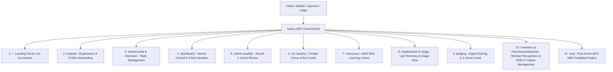

# Kairos 2027 — Official Website Specification, PRD & UX Roadmap (Grand Edition)

**Portal Domain:** `https://kairos.sathyabama.ac.in`  
**Registration Model:** **100% FREE — ZERO ENTRY FEE** (No fees collected from students at any stage)  
**Dual-Phase Quality Pipeline:** 2,000+ Online Applications $\rightarrow$ 250 Online Semi-Finalists (Jan 02–04) $\rightarrow$ 100 Elite On-Campus Teams (Jan 22–24)  
**Cash Prize Pool:** **₹1,75,000 Pure Cash** + $50,000+ AWS Cloud Credits  
**Event Window:** January 22 – 24, 2027 (Sathyabama Institute of Science and Technology, Chennai)  
**Compliance Authority:** Directly implements AWS Student Builder Group Leader guidelines from `E:\AWS SBGL\Leader Library` & `ANTI-Help`  
**Lead Coordinator:** Thenappan T (Register No: 44110855), President & SBGL | Email: `sistawscc@gmail.com`  

---

## 1. Product Requirements Document (PRD) Overview

---

## 2. Multi-Page Architecture & Route Navigation Index

The website is architected into **15 dedicated production routes** specified in detail in:  
👉 [Website Pages & Routes Deep-Dive (`website_pages_and_routes_deepdive.md`)](./website_pages_and_routes_deepdive.md)

| Route Path | Page Title | Access Control | Primary Functional Role |
|---|---|:---:|---|
| **`/`** | Home / Landing Hub | Public | Mega countdown, Dual-Phase pipeline visualizer, 5 tracks, ₹1.75L prize podium, sponsor showcase, FAQs. |
| **`/register`** | Registration Hub | Public | Student profile onboarding, track selection, zero-fee assurance. |
| **`/team/create`** | Create Team | Authenticated | Team Lead creates team, inputs project abstract, uploads architecture PDF, receives invite link. |
| **`/team/join`** | Join Team | Authenticated | Teammates join the team roster (4–6 members max). |
| **`/dashboard`** | Builder Central | Authenticated | Live status banner (`ROUND_0` $\rightarrow$ `QUALIFIER` $\rightarrow$ `FINALIST`), AWS sandbox credits, check-in pass. |
| **`/tracks`** | Enterprise Tracks Hub | Public | Deep-dive problem statements, AWS Bedrock & serverless reference architectures, bounty guidelines. |
| **`/online-qualifier`**| Round 1 Virtual Portal | Top 250 Teams | Loom 3-minute video submission, GitHub webhook telemetry, Google Meet virtual defense scheduler. |
| **`/on-campus`** | Finalist On-Campus Guide| Top 100 Teams | Central Library floorplan, direct event day venue reporting guide, university bus fleet route selector, free builder tee sizing. |
| **`/resources`** | AWS SBG Learning Library | Public | Turnkey resources from `E:\AWS SBGL\Leader Library`: Cloud Quest, Bedrock starter kits. |
| **`/leaderboard`** | Live Leaderboard | Public | Real-time Z-score normalized team standings across Checkpoints 1, 2, and 3. |
| **`/stage`** | Main Stage Screen Mode | Internal / Stage | High-contrast full-screen view for the auditorium stage (live countdown, sponsor rotation, commit feed). |
| **`/judging`** | Digital Jury Portal | PIN-Protected | Digital 100-point rubric cards for 25+ VIP judges and evaluators with instant Z-score normalization. |
| **`/sponsors`** | Corporate Sponsorship | Public | Tier-1 sponsor tiers (Title ₹2L, Powered-By ₹1L, Associate ₹50k, Track Bounties ₹25k), talent ROI. |
| **`/rules`** | Code of Conduct & IP | Public | 100% student IP ownership charter, fresh code rules, anti-harassment policy. |
| **`/members/leadership`**| Higher Management Gallery| Public | **Batch 2026–2027 Leadership Showcase:** President Thenappan T, core leads & faculty coordinators. |
| **`/members`** | All-Team Recognition Wall| Public | Public Hall of Fame for all 106 student organizers, volunteers & ambassadors. |
| **`/members/[username]`**| Individual Member Dossier| Public | Verifiable student builder portfolio, impact metrics, and tamper-proof certificate. |
| **`/csat`** | Official Post-Event CSAT| Public / Attendees| Post-event attendee satisfaction survey exporting formatted CSVs for official AWS SBG reporting. |

---

## 3. Brand & Typography Compliance (From Leader Library)

All pages adhere to the guidelines documented in:  
👉 [AWS SBG Brand & Event Toolkit Integration Manual (`aws_sbg_brand_and_event_toolkit_integration.md`)](./aws_sbg_brand_and_event_toolkit_integration.md)

* **Typography Suite:** Official `Amazon Ember Display` (Headings), `Amazon Ember` (Body), and `Amazon Ember Mono` (Code/Data) imported from `E:\AWS SBGL\Leader Library\01- Creative Assets _ Fonts, Icons, Etc_\Fonts`.
* **Brand Colors:** Deep Void Black (`#000000`), Electric Violet (`#A855F7`), Cyber Orchid (`#C084FC`), Astral White (`#FFFFFF`), and Deep Nebula Dark (`#0B0616`), alongside AWS co-branding accents.
* **Official Disclaimer:** Displayed across all footers:
  > *"AWS Student Builder Group Sathyabama is an independent student organization supported by the AWS Student Builder Groups program. Amazon Web Services, AWS, and the AWS logo are trademarks of Amazon.com, Inc. or its affiliates."*
